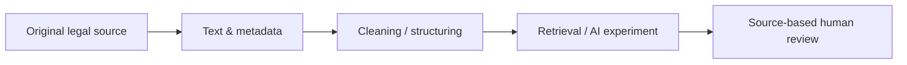

# Smart Lawyer AI | Egyptian Legal NLP Research

**Structured law texts · Data provenance · Retrieval & model-evaluation experiments**

This research repository collects materials for exploring **Egyptian legal-text processing**: ingestion, structuring, Arabic retrieval and evaluating model-assisted legal workflows. A collection of files is **not** evidence of a trained, validated or deployed legal model.

## Repository map

| Folder | Content type |
|:--|:--|
| [laws](laws) | Structured legislation materials |
| [corporate](corporate) | Corporate and investment-law materials |
| [framework](framework) | Prompting and workflow research |
| [assets](assets) | Project visual assets |

## Data and model-quality rules

- Record the **official source URL, instrument number, date and version** for every legal document.
- Never present undated or unverified reproductions as the current law.
- Keep original text separate from normalized search text and generated model output.
- Evaluate Arabic extraction accuracy, citations and error cases before public use.
- Do not upload client data, secrets, copyrighted commercial databases or proprietary internal prompts.

## Licensing

A [MIT license](LICENSE) exists in this public repository for the material to which it legally applies. Rights in third-party legal compilations, templates, documents or sources are **not** automatically granted by that file; check provenance and applicable rights separately.

**Maintainer:** [Mohamed Atef](https://github.com/matef-hub) · Egyptian lawyer and legal-technology developer.
